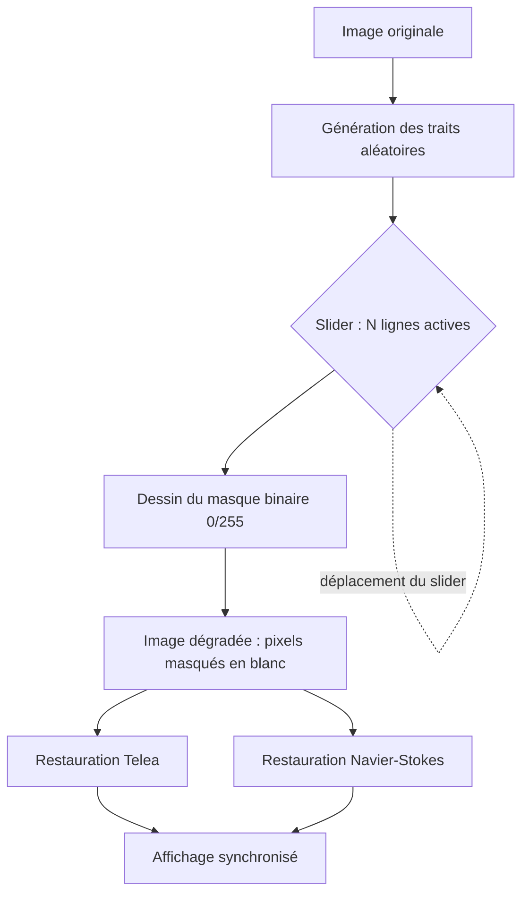

# Dégradation et restauration d'image (inpainting OpenCV)

Application interactive en Python/OpenCV : une image est volontairement dégradée par des
traits aléatoires, puis reconstruite par deux algorithmes d'inpainting. Un slider règle le
pourcentage de dégradation et met à jour **toutes les fenêtres en même temps**.

## Prérequis

- Python 3.8 ou plus
- `opencv-python` (testé avec 4.12.0)
- `numpy` (testé avec 2.3.5)

```bash
pip install opencv-python numpy
```

## Contenu du projet

```
app_traitement_image/
├── images/
│   ├── fleurs.jpeg
│   └── images.jfif          # image utilisée (717 x 428 pixels)
├── inpainting.py            # application principale : slider + 2 restaurations
└── readme.md
```

## Lancement

```bash
python inpainting.py
```

Fermeture : touche `Échap` ou `q`.

## Processus complet



### 1. Chargement de l'image

`cv.imread('images/images.jfif')` charge l'image en BGR. Si le fichier est introuvable,
le programme s'arrête avec `FileNotFoundError`.

### 2. Génération des traits aléatoires

`generer_lignes_aleatoires()` tire **25 traits** (`NB_LIGNES = 25`) :

- deux points aléatoires `(x, y)` dans les limites de l'image ;
- une épaisseur aléatoire entre 1 et 5 pixels ;
- chaque trait est stocké dans la liste `lignes`.

Les traits sont tirés **une seule fois au démarrage** : le motif reste donc identique
pendant toute la session, ce qui rend le slider prévisible.

### 3. Dessin du masque selon le slider

`dessiner_masque()` crée une matrice `uint8` de la taille de l'image, remplie de 0
(pixel sain), puis dessine en 255 (pixel à réparer) les **N premiers traits** :

```
N = round(25 * valeur_slider / 100)
```

- 0 % → aucun trait, masque entièrement noir ;
- 50 % → les 12 premiers traits ;
- 100 % → les 25 traits.

Comme les traits s'ajoutent dans un ordre fixe, revenir à une valeur du slider redonne
exactement le même masque.

### 4. Fabrication de l'image dégradée

L'image est copiée, puis tous les pixels du masque sont remplacés par du **blanc (255)** :

```python
img_abimee = img.copy()
img_abimee[masque_courant == 255] = 255
```

Le blanc simule une information perdue : l'algorithme devra la reconstruire à partir des
pixels voisins.

### 5. Restauration par inpainting

Deux méthodes OpenCV sont appliquées en parallèle sur la même image dégradée, avec un
rayon de 3 pixels :

| Méthode      | Constante            | Principe                                   |
| ------------- | -------------------- | ------------------------------------------ |
| Telea         | `cv.INPAINT_TELEA` | Remplit la zone depuis ses bords, rapide   |
| Navier-Stokes | `cv.INPAINT_NS`    | Propage couleurs et structures (gradients) |

À 0 %, aucun trait n'étant actif, `cv.inpaint` n'est pas appelé : les restaurations sont
simplement des copies de l'image originale.

### 6. Affichage synchronisé

La fonction `degradation(val)` (callback du slider) refait toute la chaîne
masque → image dégradée → restaurations, puis réaffiche les fenêtres 2 à 5 dans le même
appel. La boucle `while True: cv.waitKey(20)` fait tourner les événements de l'interface :
chaque déplacement du slider déclenche le callback et repeint immédiatement les fenêtres.

| Fenêtre                           | Contenu                                           |
| ---------------------------------- | ------------------------------------------------- |
| `1 - Image originale`            | Image intacte + slider `Degradation` (0 à 100) |
| `2 - Masque aleatoire`           | Masque réellement appliqué                      |
| `3 - Image abimee`               | Image avec les pixels masqués en blanc           |
| `4 - Restauration Telea`         | Reconstruction par Telea                          |
| `5 - Restauration Navier-Stokes` | Reconstruction par Navier-Stokes                  |

### 7. Fermeture

`Échap` ou `q` interrompt la boucle puis `cv.destroyAllWindows()` ferme les fenêtres.

## Progression de la dégradation

Mesures réalisées sur `images.jfif` (717 x 428) :

| Slider | Lignes actives |   Pixels masqués |
| -----: | -------------: | ----------------: |
|    0 % |              0 |                 0 |
|   25 % |              6 |  ~6 000 à 10 000 |
|   50 % |             12 |           ~15 000 |
|  100 % |             25 | ~23 000 à 30 000 |

Le nombre exact de pixels varie à chaque exécution puisque les traits sont tirés
aléatoirement. Plus la dégradation augmente, plus les zones blanches sont larges et plus
les restaurations s'éloignent de l'image d'origine : l'inpainting reconstruit une
information plausible, jamais l'information réellement perdue.


## Remarques

- Les traits ne sont pas reproductibles d'une exécution à l'autre (pas de graine fixée).
- Le rayon d'inpainting est constant (`rayon = 3`) ; des rayures très épaisses sont donc
  moins bien restaurées.
- Le recalcul complet à chaque valeur du slider reste fluide sur une image de cette taille.
